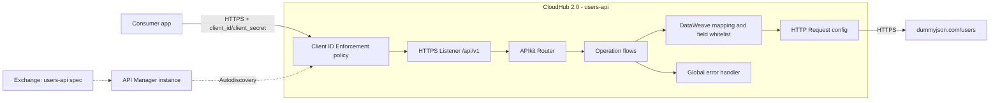

# Demo users-api project description

## Source facts the file relies on

From [DummyJSON users docs](https://dummyjson.com/docs/users):

- `GET /users` returns `{ users, total, skip, limit }`, 30 by default. `limit`, `skip`, `select`, `sortBy`, `order` are supported. `limit=0` returns everything.
- `GET /users/{id}` returns one user. An unknown id returns `404` with a `message`.
- `POST /users/add`, `PUT|PATCH /users/{id}`, `DELETE /users/{id}` are **simulated**. The response looks real (new id `209`, merged fields, `isDeleted` + `deletedOn`), but nothing is stored. A `GET` after a write returns the original data. The file must say this so testers do not log it as a bug.
- `POST /users/add` returns a full user template: the sent fields, `id: 209`, `role: "user"`, and every other field empty, including `password`, `ssn`, `bank`, `crypto`. `PUT`/`PATCH` and `DELETE` return the full user record with real values.
- Every user record contains `password`, `ssn`, `ein`, `bank`, `crypto`, `ip`, `macAddress`. The API must not return them.
- DummyJSON needs no credentials for these endpoints. All auth in this project is on our side.

## What goes into the project

### 1. Description

`users-api` is a REST API that lets internal consumer apps list, read, create, update, and delete users. It runs as one Mule 4 application on CloudHub 2.0. Behind it, DummyJSON stands in for the user system of record. The API adds things DummyJSON does not provide: a stable contract, removal of sensitive fields, consistent errors, and client ID / client secret access control.

Out of scope: real persistence, end-user login (DummyJSON `/auth`), carts / posts / todos, search and filter endpoints.

### 2. Definition

Base path `/api/v1`. OAS 3.0. Every request needs headers `client_id` and `client_secret`.

- `GET /users?limit=&skip=&sortBy=&order=` maps to `GET /users`. Returns `200 { data: [User], page: { total, limit, skip } }`. `limit` is an integer 1–100, default 30. `skip` is an integer ≥ 0, default 0. `sortBy` is one of `id`, `firstName`, `lastName`, `email`, `username`, `age`, `birthDate`. `order` is `asc` or `desc`, default `asc`. Values out of range are rejected with 400 by APIkit, so `limit=0` and `limit>100` never reach DummyJSON.
- `GET /users/{userId}` maps to `GET /users/{id}`. `userId` is an integer, minimum 1. Returns `200 User`, or `404`.
- `POST /users` maps to `POST /users/add`. Body `UserInput`: `firstName`, `lastName`, `email` (format email), `age` (integer, minimum 0) required; `phone`, `username`, `gender` (`male` or `female`), `birthDate` (`YYYY-MM-DD`), `role` (`admin`, `moderator` or `user`) optional; no other fields. Returns `201 User` with the new `id`.
- `PATCH /users/{userId}` maps to `PATCH /users/{id}`. Body `UserUpdate`: the same fields as `UserInput`, none required, at least one. Returns `200 User`, or `404`.
- `DELETE /users/{userId}` maps to `DELETE /users/{id}`. Returns `200 { id, deleted: true, deletedOn }`, or `404`.

`User` (response) whitelist: `id, firstName, lastName, email, phone, username, age, gender, birthDate, role, image, address { address, city, state, postalCode, country }, company { name, department, title }`. Anything else from DummyJSON is dropped in DataWeave, along with nulls, empty strings, and objects that end up empty. `birthDate` is returned as `YYYY-MM-DD`; DummyJSON's unpadded `1996-5-30` is normalized to `1996-05-30`.

Errors share one body: `{ code, message, correlationId }`.

- `400 BAD_REQUEST`: APIkit validation failure (bad `userId`, missing or invalid field, empty PATCH body, `limit` out of range, invalid JSON).
- `401 UNAUTHORIZED`: missing or invalid client credentials, returned by the policy.
- `404 USER_NOT_FOUND`: DummyJSON returned 404.
- `404 NOT_FOUND`: the path does not exist (APIkit).
- `405 METHOD_NOT_ALLOWED`: the path exists but the method does not (APIkit).
- `429 TOO_MANY_REQUESTS`: rate limit policy, documented on all operations.
- `500 INTERNAL_ERROR`: any other error.
- `502 BACKEND_ERROR`: DummyJSON returned 5xx.
- `504 BACKEND_TIMEOUT`: DummyJSON did not answer within `dummyjson.timeout` (default 10s).

### 3. Architecture

- **Single Mule implementation project:** `users-api`. Files: `users-api.xml` (listener, APIkit router, operation flows), `implementation-read.xml` (sub-flows for the two GET operations), `implementation-write.xml` (sub-flows for POST, PATCH, DELETE), `global.xml` (configs, error handler, autodiscovery). The field whitelist is one DataWeave module, `src/main/resources/modules/User.dwl`, used by both implementation files.
- **Auth:** API Manager **Client ID Enforcement** policy, credentials in custom headers `client_id` / `client_secret`, linked through API Autodiscovery (`api.id` property). Consumers get credentials by requesting access to the asset in Exchange. The validation code lives in the policy, not in a flow, so the Mule code does not change if the policy changes.
- **Backend calls:** one HTTP Request config, host `dummyjson.com`, port 443, HTTPS, response timeout from properties. Query params are forwarded only from the allowlist above.
- **Config:** `config-local.yaml`, `config-dev.yaml`, `config-prod.yaml` chosen by `mule.env`. `secure-<env>.yaml` holds encrypted values loaded with Secure Configuration Properties and key `mule.key`. Locally that means the Anypoint environment client ID and secret Autodiscovery needs. On CloudHub 2.0, `mule.key` is a protected property.
- **Logging:** correlation id from `x-correlation-id`, or generated. One log line in and one out per request. No user payloads in logs, and never the `client_id` / `client_secret` headers.

### 4. Tasks for the team

**Phase 0. Setting up**

- T0.1 Access and tools: ACB with Anypoint Extension Pack, Node 20, `jq`. Mule Developer Generative AI User and Exchange Contributor permissions. API Manager and Runtime Manager access to Sandbox. Done when the Vibes panel opens and the MuleSoft MCP server lists `generate_api_spec`.
- T0.2 Repo and workspace: create the repo, open it in ACB, add `.gitignore` (`target/`, `*.jks`, `.mule/`). Done when the empty workspace is pushed.
- T0.3 Workspace rules: add `.a4drules/01-users-api.md` with naming (`users-api`, `/api/v1`, camelCase), the field whitelist, the error codes above, "no secrets in XML or YAML", and "never log user payloads". Done when Vibes lists it under Workspace Rules.

**Phase 1. Design an API**

- T1.1 Create the spec project with Design an API: name `users-api-spec`, REST, OAS 3.0 YAML, add to the existing workspace. Done when the stub yaml opens.
- T1.2 Generate the spec with Vibes from definition. Five operations, `User`, `UserInput`, `UserUpdate`, `Error` schemas, `client_id`/`client_secret` header security scheme, examples for every status. Done when there are no extra endpoints and no sensitive fields in `User`.
- T1.3 Add ruleset: include `anypoint-best-practices` ruleset to the project for validation.
- T1.4 Mock and validate: Validate Project, `anypoint-best-practices` ruleset, then mock calls for `GET /users/1` (200), `GET /users/9999` (404), `POST /users` with a missing `email` (400). Done when there are zero governance errors and three expected mock results.
- T1.5 Publish `users-api-spec` `1.0.0` to Exchange. Done when the asset is visible with all five operations.

**Phase 2. API Implementation**

- T2.1 Scaffold `users-api` from the Exchange asset with APIkit. Done when the router and five flows exist and the project builds.
- T2.2 HTTP Request config for DummyJSON: HTTPS, host/port/timeout from properties. Test with `test_connection`. Done when the connection test passes.
- T2.3 Implement GET list and GET by id: forward the allowlisted query params, map to `data` + `page`, whitelist fields, normalize `birthDate`. Done when the response has no `password`, `ssn`, `bank`, or `crypto`, and `birthDate` is `YYYY-MM-DD`.
- T2.4 Implement POST, PATCH, DELETE: map `UserInput` / `UserUpdate` to DummyJSON, map responses back (`201` for create; the delete response shape above). Done when each returns the documented body.
- T2.5 Global error handler: map `HTTP:NOT_FOUND`, `HTTP:TIMEOUT`, `HTTP:INTERNAL_SERVER_ERROR` / `HTTP:BAD_GATEWAY` / `HTTP:SERVICE_UNAVAILABLE`, `APIKIT:BAD_REQUEST`, `APIKIT:NOT_FOUND`, `APIKIT:METHOD_NOT_ALLOWED`, and unexpected errors to the error body and status codes. Done when every documented error has a mapping.
- T2.6 Environment configs: `config-local/dev/prod.yaml`, `secure-*.yaml` with the Secure Configuration Properties module, `mule.key` only at runtime. Done when `grep` finds no plaintext secret.
- T2.7 API Manager and Autodiscovery: create a Sandbox API instance from the Exchange asset, add the Autodiscovery element with `${api.id}`, apply Client ID Enforcement with custom headers `client_id` / `client_secret`. Create a client app in Exchange and request access. Done when the instance shows the policy and a client app has an approved contract.

**Phase 3. Debug**

- T3.1 Run locally with `mule.env=local` and the environment credentials, and call all five operations with a valid client. Done when status codes and bodies match section 2.
- T3.2 Negative paths: no headers (401), wrong secret (401), id `9999` (404), invalid body (400), empty PATCH body (400), `limit=0` and `limit=101` (400), any call with `dummyjson.timeout=1` set locally (504). Done when each returns the documented error body.
- T3.3 Debugger walk-through: breakpoint in the PATCH flow, inspect `attributes`, `payload`, and the DataWeave output before the request. Done when the team member can explain each variable.

**Phase 4. Creating MUnit tests**

- T4.1 Generate MUnit with Vibes for all five operations. Mock HTTP Request. Each test asserts status and body shape. Done when 5 happy-path tests pass.
- T4.2 Error tests: 404 from backend, timeout, 5xx, APIkit 400. Done when all pass.
- T4.3 Security test: for all five operations, mock DummyJSON with a full user record and assert the response never contains `password` / `ssn` / `ein` / `bank` / `crypto` / `ip` / `macAddress`. Done when it passes.
- T4.4 Coverage at or above 80% on `users-api.xml`, `implementation-read.xml` and `implementation-write.xml`. Done when the report is attached to the PR.

**Phase 5. Deploy to CloudHub 2.0**

- T5.1 Deploy `users-api` to Sandbox with Vibes: one replica, Java 17 runtime, `mule.env=dev`, `api.id`, and `mule.key` as a protected property. Done when Runtime Manager shows Started and the API instance shows Active.
- T5.2 Smoke test from the public URL: five operations with valid credentials, and one call without credentials (401). Done when results match T3.1 and T3.2.
- T5.3 Stretch:
  - Rate Limiting SLA policy on the Sandbox instance. Done when an over-limit client gets 429.
  - Promote to production: create an API instance in the Production environment from the same Exchange asset, apply Client ID Enforcement there, deploy with `mule.env=prod` and that instance's `api.id`, and request access for the client app to the production instance. Done when a production call with valid credentials returns 200 and one without returns 401.

### 5. Definition of done

All five operations pass with valid credentials. Missing or invalid credentials always return 401. No sensitive DummyJSON field appears in any response. MUnit coverage is at least 80%. The app runs on CloudHub 2.0 Sandbox, and the spec `1.0.0` is in Exchange.

## Choice made without asking

Client ID / client secret is enforced with the **API Manager Client ID Enforcement policy** plus Autodiscovery, not a hand-written check in a flow. It is still one Mule project. The policy is applied to it, not built as a second app.

## Vibes log

One entry per task done with Vibes. This is the material for the talk: where Vibes saved time, where it cost time, and what had to be corrected.

| Task | Who | Prompt (short) | What Vibes got right | What had to be fixed | Time saved or lost |
|---|---|---|---|---|---|
| T0.3 | I | Write workspace rules from the definition | Allowlist, sensitive fields, error body and codes, logging, simulated writes | Wrong `GET /users` shape, unknown paths mapped to `USER_NOT_FOUND`, all non-2xx mapped to 502, per-flow error handlers, invented file layout, kebab-case renaming of APIkit flows, `SECURE_KEY` instead of `mule.key`, `deletedOn` missing, `birthDate` as ISO-8601, missing query params and request bodies | Fast draft, but a full review against the plan was needed |
| T1.1 | A | Create the spec project with Design an API: name users-api-spec, REST, OAS 3.0 YAML | Exchange file definition, project structure | Nothing, this is a simple task | Fast project draft, no addtional review needed |
| T1.2 | A | Generate the spec with Vibes from definition (full prompt in `users-api-spec/Create an OpenAPI 3.0.3 specificatiom Prompt.txt`) | Five operations, no extra endpoints. `User` whitelist with no sensitive fields. `client_id`/`client_secret` header schemes applied globally. Reusable parameters with correct ranges and defaults. `UserInput` with `additionalProperties: false`, `UserUpdate` with `minProperties: 1`, `birthDate` pattern, `data` + `page` list shape, `{ id, deleted, deletedOn }` delete body. Examples for every status, including the POST 201 with empty fields dropped. Simulated writes explained in descriptions | Nothing in the generated YAML. The prompt needed two revisions first: PUT changed to PATCH. Error enum missing `NOT_FOUND`, `METHOD_NOT_ALLOWED`, `INTERNAL_ERROR`. 404 split into two reusable responses (`NotFound` for `/users`, `UserOrNotFound` with two examples for `/users/{userId}`), because OAS allows one 404 per operation. 405 and 500 missing. 502 mapped to specific `HTTP:*` errors | Large time saving: about 900 lines in one pass. The time went into making the prompt precise enough, not into fixing the output |

